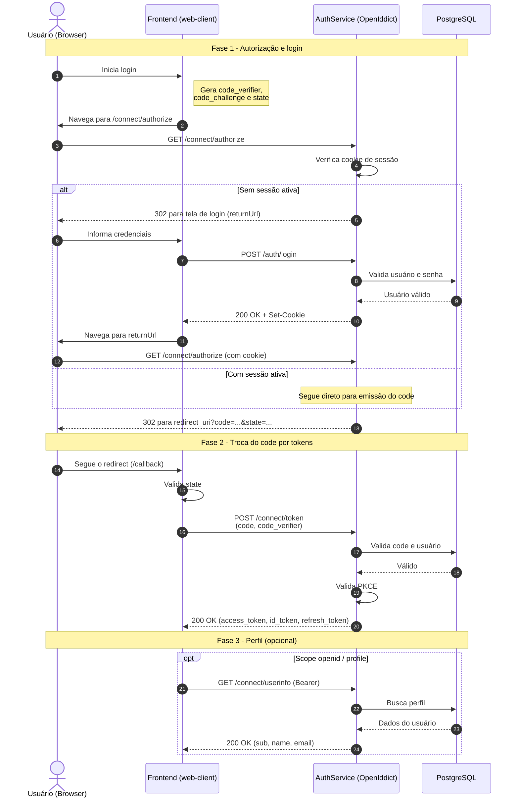
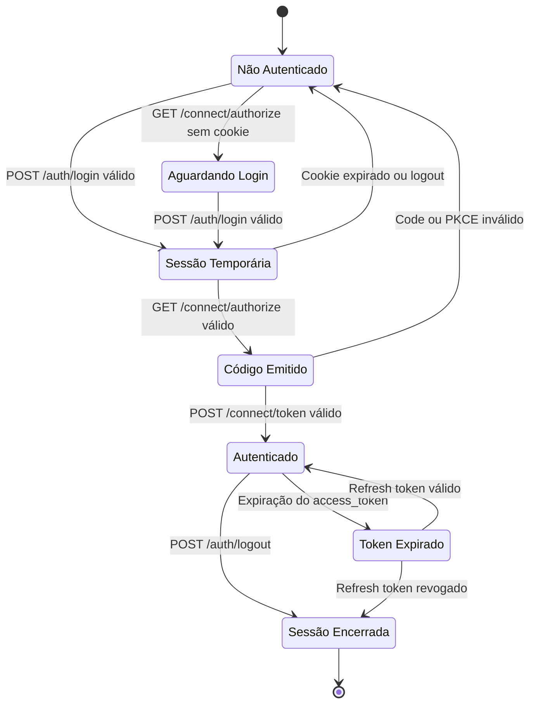

# Documentação do Serviço de Autenticação (`AuthService`)

Este documento descreve a arquitetura, os endpoints, os contratos de entrada e saída e o fluxo principal de autenticação OAuth 2.0 / OpenID Connect (OIDC) do microsserviço **AuthService**.

O serviço foi desenvolvido em **.NET 10 (`net10.0`)** utilizando **Minimal APIs**, **OpenIddict 7.9.0**, **Entity Framework Core + PostgreSQL** e **BCrypt.Net-Next** para hash de senhas.

---

## Visão Geral e Configurações Relevantes

* **URLs Locais (Perfil `https` / `http` / Docker):**
  * HTTPS local: `https://localhost:7049`
  * HTTP local: `http://localhost:5077`
  * Container Docker HTTP: `http://localhost:8080`
  * Container Docker HTTP: `https://localhost:8081`
  
* **Escopos OIDC/OAuth 2.0 Registrados:** `openid`, `email`, `profile`, `offline_access`.
* **Fluxos Habilitados no Servidor OpenIddict:**
  * `authorization_code` (com **PKCE obrigatório** em nível de servidor)
  * `refresh_token` (com rotação de tokens gerenciada pelo OpenIddict)
  * `client_credentials` (autenticação máquina-a-máquina / M2M)
* **Formato dos Tokens:** A criptografia do `access_token` está desabilitada (`DisableAccessTokenEncryption()`), portanto os `access_token`s são **JWTs assinados** que podem ser validados de forma *stateless* pelos demais microsserviços usando o endpoint JWKS (`/.well-known/jwks`).
* **Sessão Temporária de Login:** O endpoint `POST /auth/login` emite o cookie `.AuthService.Session` (`HttpOnly`, `SameSite=Lax`, validade fixa de **15 minutos** sem *sliding expiration*), utilizado exclusivamente para autenticar o usuário durante o redirecionamento ao `/connect/authorize`.
* **Tratamento Global de Erros:** Exceções não tratadas e erros de deserialização são convertidos em respostas padronizadas `ProblemDetails` (RFC 7807/9457) pelo `GlobalExceptionHandler`.
* **Clientes Pré-cadastrados (`OpenIddictSeeder`):**
  * `web-client` (Público): suporta `authorization_code` e `refresh_token`, exige PKCE (`RequirePkce: true`), escopos `openid`, `email`, `profile`, `offline_access`, `redirect_uri` padrão `http://localhost:3000/callback`.
  * `service-client` (Confidencial): suporta `client_credentials` (`RequirePkce: false`).

---

## Diagrama do Fluxo Principal de Autenticação (OAuth 2.0 Authorization Code + PKCE)

O diagrama abaixo ilustra o fluxo completo de autenticação de usuário via **Authorization Code + PKCE** integrado à sessão temporária do `/auth/login`:



---

## Diagrama de Estado do Fluxo de Autenticação

O diagrama abaixo representa o ciclo de estados da autenticação do usuário no `AuthService` (em **Autenticado**, o cliente também pode consultar `GET /connect/userinfo` com o `access_token` e revogar tokens em `POST /connect/revoke`):



---

## Mapa Resumido de Rotas

| Método | Rota | Grupo / Camada | Implementação | Descrição Resumida |
| :--- | :--- | :--- | :--- | :--- |
| `GET` | `/` | Saúde | Minimal API (`Program.cs`) | Verifica se o serviço está em funcionamento. |
| `GET` | `/.well-known/openid-configuration` | Discovery OIDC | Automática (OpenIddict) | Metadados públicos do servidor OpenID Connect. |
| `GET` | `/.well-known/jwks` | Criptografia / JWKS | Automática (OpenIddict) | Chaves públicas para validação local de JWTs. |
| `POST` | `/auth/register` | Gestão de Usuários | Minimal API (`AuthEndpoints`) | Cadastra um novo usuário com hash BCrypt. |
| `POST` | `/auth/login` | Gestão de Sessão | Minimal API (`AuthEndpoints`) | Autentica credenciais e emite o cookie temporário `.AuthService.Session`. |
| `POST` | `/auth/logout` | Gestão de Sessão | Minimal API (`AuthEndpoints`) | Remove o cookie de sessão e revoga os `refresh_token`s do usuário. |
| `GET` | `/connect/authorize` | OAuth 2.0 / OIDC | Híbrida (*Passthrough*) | Inicia o fluxo Authorization Code + PKCE e emite o `code`. |
| `POST` | `/connect/token` | OAuth 2.0 / OIDC | Híbrida (*Passthrough*) | Emite tokens (`authorization_code`, `refresh_token`, `client_credentials`). |
| `POST` | `/connect/revoke` | OAuth 2.0 (RFC 7009) | Automática (OpenIddict) | Revoga um token específico (ex.: `refresh_token`). |
| `GET` | `/connect/userinfo` | OpenID Connect | Híbrida (*Passthrough*) | Retorna as claims atualizadas do usuário autenticado via Bearer token. |

> **Observação (Ambiente `Development`):** Quando executado com `ASPNETCORE_ENVIRONMENT=Development`, a aplicação também expõe a especificação OpenAPI em `/openapi/v1.json` e a interface interativa Scalar em `/scalar`.

---

## 1. Rotas de Saúde e Descoberta OIDC

### `GET /`

Endpoint básico de *health check* para verificar a disponibilidade da aplicação.

* **Entradas:** Nenhuma.
* **Saídas:**
  * `200 OK` (`text/plain`): `"Em funcionamento"`

---

### `GET /.well-known/openid-configuration`

Endpoint padrão de descoberta OpenID Connect (RFC 8414 / OIDC Discovery), gerenciado automaticamente pelo middleware do OpenIddict. Permite que clientes e *Resource Servers* descubram dinamicamente o `issuer`, as URLs dos endpoints, os escopos e os algoritmos suportados.

* **Entradas:** Nenhuma.
* **Saídas:**
  * `200 OK` (`application/json`): Documento de metadados OIDC contendo propriedades como `issuer`, `authorization_endpoint`, `token_endpoint`, `revocation_endpoint`, `userinfo_endpoint`, `jwks_uri`, `grant_types_supported`, `scopes_supported`, `code_challenge_methods_supported`, entre outras.

---

### `GET /.well-known/jwks`

Endpoint *JSON Web Key Set* (JWKS), gerenciado automaticamente pelo OpenIddict. Expõe as chaves públicas correspondentes ao certificado de assinatura configurado (certificado de desenvolvimento em `Development` ou arquivo PKCS#12 em produção).

* **Entradas:** Nenhuma.
* **Saídas:**
  * `200 OK` (`application/json`): Objeto `{ "keys": [ ... ] }` contendo o conjunto de chaves públicas em formato JWK para verificação assimétrica de assinaturas JWT.

---

## 2. Rotas de Usuários e Sessão (`/auth`)

### `POST /auth/register`

Cria uma nova conta de usuário na tabela própria (`Users`). O e-mail é normalizado (`Trim().ToLowerInvariant()`) para evitar duplicidade por variação de caixa ou espaços, e a senha é armazenada utilizando hash BCrypt (`BCrypt.Net.BCrypt.HashPassword`).

#### Entradas

* **Content-Type:** `application/json`
* **Body (`RegisterRequest`):**

| Campo | Tipo | Obrigatório | Regras de Validação | Descrição |
| :--- | :--- | :--- | :--- | :--- |
| `name` | `string` | Sim | Entre 1 e 200 caracteres | Nome de exibição do usuário. |
| `email` | `string` | Sim | Formato de e-mail válido; máx. 256 caracteres | Endereço de e-mail único do usuário. |
| `password` | `string` | Sim | Entre 8 e 128 caracteres | Senha em texto plano (convertida em hash BCrypt no servidor). |

```json
{
  "name": "Usuário Teste",
  "email": "teste@exemplo.com",
  "password": "Password123!"
}
```

#### Saídas

| Status HTTP | Cenário | Corpo / Headers |
| :--- | :--- | :--- |
| `201 Created` | Usuário criado com sucesso | Sem corpo (`Location` vazio). |
| `400 Bad Request` | Falha na validação dos campos (`ValidationProblem`) | JSON `HttpValidationProblemDetails` com `title: "Erro ao validar requisição"` e dicionário `errors` por propriedade. |
| `409 Conflict` | E-mail já cadastrado | JSON `ProblemDetails`: `{ "title": "E-mail já cadastrado.", "detail": "Já existe uma conta registrada com o e-mail informado.", "status": 409 }`. |

---

### `POST /auth/login`

Valida as credenciais do usuário contra o hash BCrypt armazenado no banco de dados. Em caso de sucesso, retorna os dados básicos do usuário e emite o cookie temporário de sessão `.AuthService.Session`, necessário para prosseguir no endpoint `/connect/authorize`.

#### Entradas

* **Content-Type:** `application/json`
* **Body (`LoginRequest`):**

| Campo | Tipo | Obrigatório | Regras de Validação | Descrição |
| :--- | :--- | :--- | :--- | :--- |
| `email` | `string` | Sim | Formato de e-mail válido; máx. 256 caracteres | E-mail cadastrado do usuário. |
| `password` | `string` | Sim | Máx. 128 caracteres | Senha do usuário. |

```json
{
  "email": "teste@exemplo.com",
  "password": "Password123!"
}
```

#### Saídas

| Status HTTP | Cenário | Corpo / Headers |
| :--- | :--- | :--- |
| `200 OK` | Autenticação bem-sucedida | **Header:** `Set-Cookie: .AuthService.Session=...; HttpOnly; SameSite=Lax` (validade de 15 min).<br>**Body (`UserResponse`):** `{ "id": "uuid", "name": "string", "email": "string" }`. |
| `400 Bad Request` | Falha na validação dos campos (`ValidationProblem`) | JSON `HttpValidationProblemDetails` com `title: "Erro ao validar requisição"` e `errors`. |
| `401 Unauthorized` | Usuário não encontrado ou senha incorreta | JSON `ProblemDetails`: `{ "title": "Credenciais inválidas.", "detail": "E-mail ou senha inválidos.", "status": 401 }`. |

---

### `POST /auth/logout`

Encerra a sessão do usuário autenticado:

1. Tenta identificar o ID do usuário (`sub` / `NameIdentifier`) primeiro pelo token **Bearer** (validado via `OpenIddictValidationAspNetCoreDefaults`) e, caso ausente, pelo cookie `.AuthService.Session`.
2. Descarta o cookie `.AuthService.Session` da resposta (`SignOutAsync`).
3. Caso o usuário seja identificado, revoga no banco de dados todos os `refresh_token`s válidos (`Statuses.Valid`) associados a esse `subject` por meio de `IOpenIddictTokenManager.RevokeAsync`.

#### Entradas

* **Body:** Nenhum.
* **Autenticação (uma das opções abaixo):**
  * **Header:** `Authorization: Bearer <access_token>`
  * **Cookie:** `.AuthService.Session=<valor_do_cookie>`

#### Saídas

| Status HTTP | Cenário | Corpo / Headers |
| :--- | :--- | :--- |
| `204 No Content` | Sessão encerrada e refresh tokens revogados | Sem corpo. Remove o cookie `.AuthService.Session`. |
| `401 Unauthorized` | Nenhuma identidade autenticada encontrada (nem Bearer válido, nem cookie válido) | Remove o cookie `.AuthService.Session` (se houver).<br>**Body (`ProblemDetails`):** `{ "title": "Sessão não encontrada.", "detail": "Não foi possível identificar um usuário autenticado para encerrar a sessão.", "status": 401 }`. |

---

## 3. Rotas OAuth 2.0 / OpenID Connect (`/connect`)

### `GET /connect/authorize`

Inicia o fluxo interativo **Authorization Code + PKCE**.

1. O middleware do OpenIddict valida `client_id`, `redirect_uri`, `response_type`, escopos permitidos e requisitos de PKCE (`code_challenge` / `code_challenge_method`).
2. O handler verifica o cookie `.AuthService.Session` e consulta o usuário no PostgreSQL.
3. Se o cookie estiver ausente/inválido ou o usuário não existir mais, o cookie é limpo (se presente) e o navegador é redirecionado para `Authentication:LoginUrl` (padrão configurado: `http://localhost:3000/login`) com o parâmetro `ReturnUrl` apontando para a requisição original de `/connect/authorize`.
4. Se autenticado, o OpenIddict emite o `authorization_code` e redireciona o navegador para `redirect_uri`.

#### Entradas (Parâmetros OAuth 2.0 / PKCE)

| Parâmetro | Local | Obrigatório | Tipo / Valor | Descrição |
| :--- | :--- | :--- | :--- | :--- |
| `client_id` | Query | **Sim** | `string` (ex.: `web-client`) | Identificador público da aplicação cliente registrada no OpenIddict. |
| `redirect_uri` | Query | **Sim** | `string` URL (ex.: `http://localhost:3000/callback`) | URI exata de callback cadastrada para o cliente. |
| `response_type` | Query | **Sim** | `"code"` | Tipo de resposta exigido pelo Authorization Code Flow. |
| `code_challenge` | Query | **Sim** | `string` (Base64URL) | Desafio PKCE derivado do `code_verifier` (obrigatório globalmente). |
| `code_challenge_method` | Query | **Sim** | `"S256"` (recomendado) | Método usado para gerar o `code_challenge` (`SHA-256` em Base64URL). |
| `scope` | Query | Condicional | `string` separado por espaço (ex.: `openid email profile offline_access`) | Escopos solicitados. `openid` é necessário para fluxo OIDC (`id_token` / `/connect/userinfo`) e `offline_access` para emissão de `refresh_token`. |
| `state` | Query | Recomendado | `string` opaca (ex.: `xyz123`) | Valor aleatório gerado pelo cliente para proteção contra CSRF; devolvido intacto no redirecionamento. |
| `.AuthService.Session` | Cookie | **Sim** (para emissão do código) | Cookie de sessão | Cookie emitido por `POST /auth/login`. Se ausente, aciona redirecionamento para `LoginUrl`. |

#### Saídas

| Status HTTP | Cenário | Destino / Parâmetros de Saída |
| :--- | :--- | :--- |
| `302 Found` | Usuário autenticado e requisição válida | **Header `Location`:** `<redirect_uri>?code=<authorization_code>&state=<state>` |
| `302 Found` | Usuário não autenticado (sem cookie válido ou usuário não encontrado) | **Header `Location`:** `<Authentication:LoginUrl>?ReturnUrl=<url_original_de_authorize>` |
| `302 Found` / `400 Bad Request` | Erro de validação OAuth (ex.: `client_id` inválido, `redirect_uri` não autorizada, PKCE ausente) | Se `redirect_uri` for válida e confiável, redireciona com `?error=...&error_description=...&state=...`; caso `client_id` ou `redirect_uri` sejam inválidos, responde `400 Bad Request` diretamente. |

---

### `POST /connect/token`

Endpoint central de emissão e renovação de tokens (`access_token`, `id_token`, `refresh_token`). Utiliza `Content-Type: application/x-www-form-urlencoded` (com antiforgery desabilitado para chamadas M2M e backend-to-backend).

O formato dos parâmetros de entrada varia conforme o `grant_type` utilizado:

#### Entradas — Visão Estruturada por `grant_type`

##### A) Parâmetro Comum

| Parâmetro | Local | Obrigatório | Valores Suportados | Descrição |
| :--- | :--- | :--- | :--- | :--- |
| `grant_type` | Form Body | **Sim** | `authorization_code` \| `refresh_token` \| `client_credentials` | Define o fluxo de concessão de tokens executado. |

##### B) Fluxo `grant_type=authorization_code` (Troca de Código + PKCE)

| Parâmetro | Local | Obrigatório | Tipo / Exemplo | Descrição |
| :--- | :--- | :--- | :--- | :--- |
| `grant_type` | Form Body | **Sim** | `"authorization_code"` | Identifica a troca do código de autorização por tokens. |
| `client_id` | Form Body (ou Basic Auth) | **Sim** | `string` (ex.: `web-client`) | Identificador do cliente que obteve o `code`. |
| `client_secret` | Form Body (ou Basic Auth) | Condicional | `string` (omitido para clientes públicos) | Obrigatório apenas para clientes confidenciais (que possuem `ClientSecret` cadastrado). Clientes públicos como `web-client` devem omitir este parâmetro. |
| `code` | Form Body | **Sim** | `string` | Código de autorização retornado pelo `/connect/authorize`. |
| `redirect_uri` | Form Body | **Sim** | `string` URL | Deve corresponder exatamente à `redirect_uri` enviada em `/connect/authorize`. |
| `code_verifier` | Form Body | **Sim** | `string` (43–128 chars) | Segredo original PKCE cujo hash corresponde ao `code_challenge` enviado anteriormente. |

##### C) Fluxo `grant_type=refresh_token` (Renovação de Tokens)

| Parâmetro | Local | Obrigatório | Tipo / Exemplo | Descrição |
| :--- | :--- | :--- | :--- | :--- |
| `grant_type` | Form Body | **Sim** | `"refresh_token"` | Identifica a renovação de sessão via refresh token. |
| `client_id` | Form Body (ou Basic Auth) | **Sim** | `string` (ex.: `web-client`) | Identificador da aplicação cliente. |
| `client_secret` | Form Body (ou Basic Auth) | Condicional | `string` (omitido para clientes públicos) | Obrigatório apenas para clientes confidenciais; omitido para clientes públicos como `web-client`. |
| `refresh_token` | Form Body | **Sim** | `string` | Refresh token válido emitido anteriormente (requer escopo `offline_access`). |
| `scope` | Form Body | Opcional | `string` separado por espaço | Permite *downscoping* (solicitar um subconjunto dos escopos concedidos originalmente). Se omitido, mantém os escopos originais. |

##### D) Fluxo `grant_type=client_credentials` (Autenticação Máquina-a-Máquina / M2M)

| Parâmetro | Local | Obrigatório | Tipo / Exemplo | Descrição |
| :--- | :--- | :--- | :--- | :--- |
| `grant_type` | Form Body | **Sim** | `"client_credentials"` | Identifica autenticação direta entre serviços sem usuário final. |
| `client_id` | Form Body (ou Basic Auth) | **Sim** | `string` (ex.: `service-client`) | Identificador do serviço cliente. |
| `client_secret` | Form Body (ou Basic Auth) | **Sim** | `string` (ex.: `service-secret-123`) | Segredo do serviço cliente autenticado pelo OpenIddict. |
| `scope` | Form Body | Opcional | `string` separado por espaço | Escopos solicitados permitidos ao cliente. |

#### Saídas (`POST /connect/token`)

* **Sucesso (`200 OK` - `application/json`):**

| Campo | Tipo | Quando é Retornado | Descrição |
| :--- | :--- | :--- | :--- |
| `access_token` | `string` (JWT) | Sempre | Token de acesso assinado contendo as claims do sujeito (`sub`, `name`, e `email` no caso de usuário). |
| `token_type` | `string` | Sempre | `"Bearer"`. |
| `expires_in` | `number` | Sempre | Tempo de vida do `access_token` em segundos. |
| `scope` | `string` | Quando há escopos | Lista de escopos efetivamente concedidos, separados por espaço. |
| `id_token` | `string` (JWT) | Fluxo de usuário com escopo `openid` | Token de identidade OIDC. Inclui `sub`; inclui `name` se escopo `profile` concedido e `email` se escopo `email` concedido. |
| `refresh_token` | `string` | Fluxo de usuário com escopo `offline_access` | Token para renovação posterior. Em `grant_type=refresh_token`, um novo par é emitido com rotação automática. |

```json
{
  "access_token": "eyJhbGciOiJSUzI1NiIs...",
  "token_type": "Bearer",
  "expires_in": 3599,
  "scope": "openid email profile offline_access",
  "id_token": "eyJhbGciOiJSUzI1NiIs...",
  "refresh_token": "CfDJ8..."
}
```

* **Erros (`400 Bad Request` / `401 Unauthorized` - `application/json`):**

| Campo | Tipo | Códigos Comuns | Descrição |
| :--- | :--- | :--- | :--- |
| `error` | `string` | `invalid_grant`, `invalid_client`, `unsupported_grant_type`, `invalid_request` | Código padronizado de erro OAuth 2.0. |
| `error_description` | `string` | — | Mensagem descritiva do motivo da rejeição (ex.: código/refresh token inválido, usuário não encontrado, `grant_type` não suportado). |

---

### `POST /connect/revoke`

Endpoint padronizado pela **RFC 7009** e gerenciado 100% automaticamente pelo middleware do OpenIddict para revogação explícita de tokens (principalmente `refresh_token`).

#### Entradas

* **Content-Type:** `application/x-www-form-urlencoded`

| Parâmetro | Local | Obrigatório | Tipo / Exemplo | Descrição |
| :--- | :--- | :--- | :--- | :--- |
| `token` | Form Body | **Sim** | `string` | O token a ser revogado (ex.: valor do `refresh_token`). |
| `token_type_hint` | Form Body | Opcional | `"refresh_token"` \| `"access_token"` | Dica para o servidor identificar o tipo do token informado. |
| `client_id` | Form Body (ou Basic Auth) | **Sim** | `string` (ex.: `web-client`) | Identificador do cliente proprietário do token. |
| `client_secret` | Form Body (ou Basic Auth) | Condicional | `string` (omitido para clientes públicos) | Obrigatório apenas para clientes confidenciais; omitido para clientes públicos como `web-client`. |

#### Saídas

| Status HTTP | Cenário | Corpo |
| :--- | :--- | :--- |
| `200 OK` | Token revogado com sucesso (ou token inexistente/já inválido, conforme RFC 7009) | Vazio (`{}` ou sem conteúdo relevante). |
| `400 Bad Request` / `401 Unauthorized` | Parâmetros obrigatórios ausentes ou falha de autenticação do cliente | JSON padrão OAuth 2.0 `{ "error": "...", "error_description": "..." }`. |

---

### `GET /connect/userinfo`

Endpoint OpenID Connect UserInfo. Valida o `access_token` enviado no header `Authorization`, exige o escopo `openid` e consulta os dados atualizados do usuário diretamente no PostgreSQL (permitindo refletir alterações recentes de perfil sem esperar a expiração do token).

#### Entradas

| Parâmetro | Local | Obrigatório | Formato | Descrição |
| :--- | :--- | :--- | :--- | :--- |
| `Authorization` | Header | **Sim** | `Bearer <access_token>` | Token de acesso JWT válido emitido para um usuário com o escopo `openid`. |

#### Saídas

* **Sucesso (`200 OK` - `application/json`):**

| Campo (Claim) | Tipo | Condição de Inclusão | Descrição |
| :--- | :--- | :--- | :--- |
| `sub` | `string` (UUID) | Sempre | Identificador único do usuário. |
| `name` | `string` | Token possui escopo `profile` | Nome atualizado do usuário no banco de dados. |
| `email` | `string` | Token possui escopo `email` | E-mail atualizado do usuário no banco de dados. |

```json
{
  "sub": "3fa85f64-5717-4562-b3fc-2c963f66afa6",
  "name": "Usuário Teste",
  "email": "teste@exemplo.com"
}
```

* **Erros:**

| Status HTTP | Código OAuth (`WWW-Authenticate`) | Cenário |
| :--- | :--- | :--- |
| `401 Unauthorized` | `invalid_token` | Header ausente, token expirado/inválido, `sub` inválido ou usuário associado não encontrado no banco. |
| `403 Forbidden` | `insufficient_scope` | O `access_token` é válido, porém não possui o escopo `openid`. |
